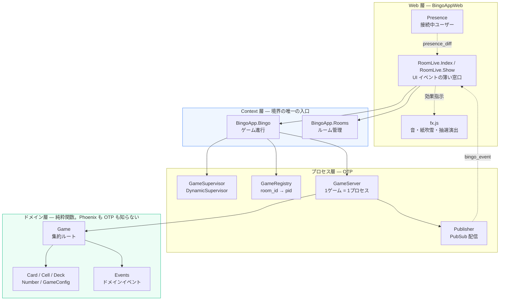

# bingo_app 設計ドキュメント

Elixir / Phoenix LiveView で作ったオンラインビンゴアプリの設計書。
DDD（ドメイン駆動設計）の考え方に沿って、**ドメインロジックを純粋関数に閉じ込め、
プロセスとプロセス境界は OTP に任せる**方針で構成している。

> `doc/` ではなく `docs/` に置いているのは、`doc/` が ExDoc（`mix docs`）の
> 出力先で、生成物と手書きのドキュメントが混ざるため。

## 目次

| ドキュメント | 内容 |
|---|---|
| [architecture.md](architecture.md) | 境界づけられたコンテキスト、レイヤの依存方向、OTP のプロセス構成 |
| [domain-model.md](domain-model.md) | 集約・エンティティ・値オブジェクト・ドメインイベント、状態遷移、不変条件 |
| [usecases.md](usecases.md) | アクターとユースケース一覧、主要シナリオのシーケンス図 |
| [decisions.md](decisions.md) | 設計判断とその理由（なぜそうしなかったか を含む） |

> 図は Mermaid で書いてある。GitHub / VSCode のプレビューでそのまま描画される。

## 全体像



**依存は上から下への一方通行**。ドメイン層は Phoenix も OTP も知らず、
Web 層は Context 層より内側を（操作のためには）参照しない。

## この設計の要点

1. **1ゲーム = 1集約 = 1プロセス** — GenServer がメッセージを直列処理するので、
   楽観ロックやトランザクションなしで整合性が守られる
2. **ドメインは `{:ok, game, events}` を返すだけ** — 判断は純粋関数、副作用（PubSub 配信）は GenServer。
   おかげでビンゴ判定はプロセスを起動せずにテストできる
3. **集約の state は外に出ない** — 読み取りは閲覧者視点に射影した `Snapshot` のみ
4. **画面更新の経路は PubSub の 1 本だけ** — 自分の操作の結果も他人の操作の結果も同じ道を通る

## 現状のテスト

| 層 | ファイル | 件数 | 何を検証しているか |
|---|---|---:|---|
| 値オブジェクト | `card_test` `deck_test` `number_test` | 37 | ビンゴ判定、列の割当、カード生成の妥当性 |
| 集約 | `game_test` | 38 | 不変条件 8 つ。プロセスも PubSub も起動しない |
| プロセス層 | `game_server_test` | 25 | Registry 解決、ルーム独立性、イベント配信、直列化 |
| Web 層 | `room_live_test` | 16 | 2ブラウザ間のリアルタイム同期、認可、演出トリガ |

```
mix test    # 120 tests + 2 doctests
```
