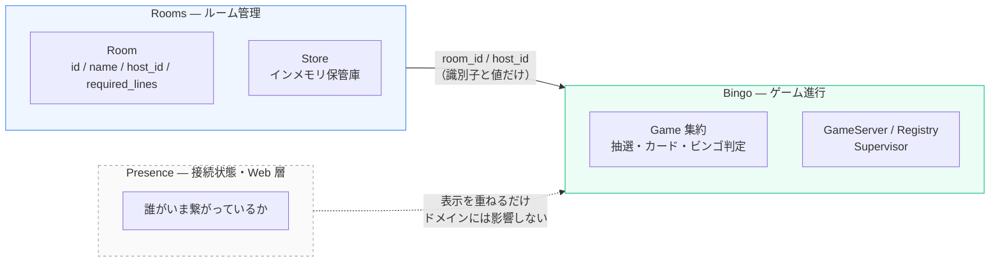
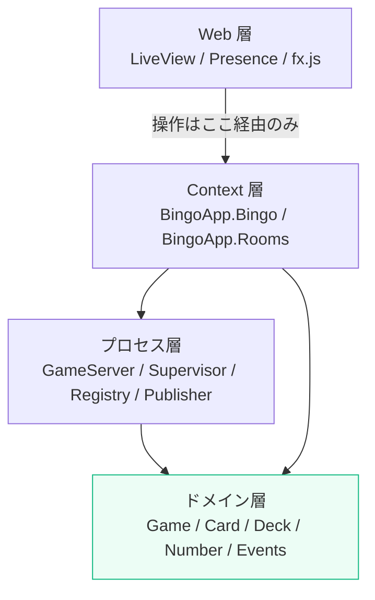
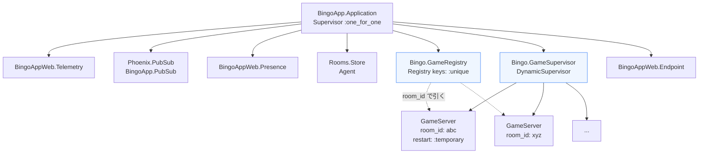
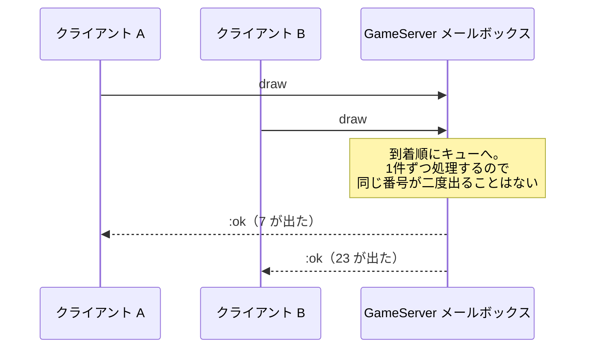

# アーキテクチャ

## 1. 境界づけられたコンテキスト（Bounded Context）



| コンテキスト | 責務 | 状態の寿命 | 変化の速さ |
|---|---|---|---|
| `Rooms` | 部屋の作成・一覧・削除、誰が主催者か | 部屋が消えるまで | 遅い（CRUD 的） |
| `Bingo` | 抽選、カード配布、自動マーク、ビンゴ判定、順位 | ゲーム中だけ（メモリ） | 速い（毎秒変わる） |
| `Presence` | オンライン表示 | 接続中だけ | 接続イベント次第 |

### なぜ Rooms と Bingo を分けたか

同じ「ルーム」という言葉でも、**ライフサイクルと整合性の要求がまったく違う**。

- `Rooms` は「部屋が存在するか」という一覧性のある情報で、DB に置きたくなる種類のもの
- `Bingo` は「いま何が引かれたか」という揮発的な情報で、DB に毎回書く価値が薄い

これを 1 つのモジュールに混ぜると、永続化の方針が引きずられて片方が不自然になる。
両者は **`room_id` という識別子だけ**で繋がり、互いの構造体を直接やり取りしない。

> 主催者が誰かという情報（`host_id`）だけは、ゲーム起動時に `Rooms` から `Bingo` へ
> **値として渡される**（参照ではない）。境界をまたぐときは値をコピーする、という原則どおり。

### なぜ「参加者」と「接続中ユーザー」を分けたか

「参加者」という語は 2 つの別の概念を含んでいる。

- **ドメイン上の参加者** — カードを持ち、ビンゴを達成しうる存在 → `Game` 集約の中
- **接続中のユーザー** — いまブラウザを開いている人 → `Presence`

混ぜると「回線が切れたらカードが消える」設計になる。
分けたので、**リロードしても再入室して同じカードを引き継げる**。
Presence はあくまでオンライン表示の飾りで、ゲームの正はいつも集約側にある。

---

## 2. レイヤと依存方向



### 守っているルール

1. `lib/bingo_app/bingo/` の純粋モジュール群は `Phoenix.*` を一切 alias しない
2. LiveView は `BingoApp.Bingo.Game` / `GameServer` / `GameRegistry` を**操作のために**直接呼ばない
3. 例外として LiveView は `Card` / `Cell` / `Number` を**読み取りのためだけ**に参照する
   （不変の値オブジェクトで、そこから集約の状態を変える経路が存在しないため）

### 各層の責務

| 層 | やること | **やらないこと** |
|---|---|---|
| Web | UI イベントの受け取り、描画、演出の指示 | ビジネスルールの判断 |
| Context | 境界の入口、プロセス解決の隠蔽、エラー文言への翻訳 | 状態の保持 |
| プロセス | 状態の保持、現在時刻の供給、イベントの配信 | ルールの判断 |
| ドメイン | 「現在の状態 + 操作 → 新しい状態 + 起きたこと」の計算 | 副作用（時刻取得・配信・永続化） |

---

## 3. OTP のプロセス構成



起動順は入れ替えられない。`GameRegistry` が先に立ち上がっていないと
`GameServer` が `{:via, Registry, ...}` で自分を登録できない。

### 集約 = プロセスにすると何が嬉しいか

GenServer はメッセージを 1 件ずつ順に処理する。つまり
**「2 人が同時に操作して状態が壊れる」ことが原理的に起きない**。
DDD で普通なら必要になる楽観ロックやトランザクション制御が、
プロセスという言語機構だけで済む。



### `restart: :temporary` にしている理由

`GameServer` は再起動しない。ゲームの状態はメモリ上にしかないので、
クラッシュ後に再起動しても **空っぽのゲームが同じ room_id で復活する**だけ。
参加者から見ればカードも抽選履歴も消えている。それは「復旧」ではなく
「静かな事故」なので、落ちきらせて「ゲームが終了した」と見せるほうが正直。

> 状態を残したいなら、イベントを永続化して再生する設計が別途必要になる。
> 今はメモリのみと決めているので、この割り切りを明示している。

### アイドルタイムアウト

ルームは自由に作れるので、誰も操作しないまま放置されたゲームは
60 分で自身を停止する（`GameServer` の `@idle_timeout`）。
Registry は死んだプロセスの登録を自動で解除するので、後始末は不要。

---

## 4. ディレクトリ構成

```
lib/
├── bingo_app/
│   ├── application.ex             スーパービジョンツリー
│   │
│   ├── rooms.ex                   ★ Context API（Rooms 境界の入口）
│   ├── rooms/
│   │   ├── room.ex                エンティティ
│   │   └── store.ex               インメモリ保管庫（差し替え可能）
│   │
│   ├── bingo.ex                   ★ Context API（Bingo 境界の入口）
│   └── bingo/
│       ├── number.ex              値オブジェクト  ┐
│       ├── cell.ex                値オブジェクト  │
│       ├── card.ex                値オブジェクト  │ 純粋関数のみ
│       ├── deck.ex                値オブジェクト  │ Phoenix も OTP も
│       ├── game_config.ex         値オブジェクト  │ 知らない
│       ├── participant.ex         エンティティ    │
│       ├── events.ex              ドメインイベント│
│       ├── game.ex                ★ 集約ルート   ┘
│       │  ───────────────────────────────────────────
│       ├── game_server.ex         GenServer（状態保持＋配信）
│       ├── game_supervisor.ex     DynamicSupervisor
│       ├── game_registry.ex       room_id → pid
│       ├── publisher.ex           PubSub 配信
│       └── snapshot.ex            読み取り専用ビューモデル
│
└── bingo_app_web/
    ├── presence.ex                接続中ユーザー
    ├── plugs/visitor_id.ex        participant_id をセッションに発行
    ├── live/room_live/
    │   ├── index.ex               ルーム一覧・作成
    │   └── show.ex                ゲーム画面
    └── components/

assets/js/fx.js                    演出（Web Audio API / 紙吹雪 / ルーレット）

docs/                              このドキュメント
```
