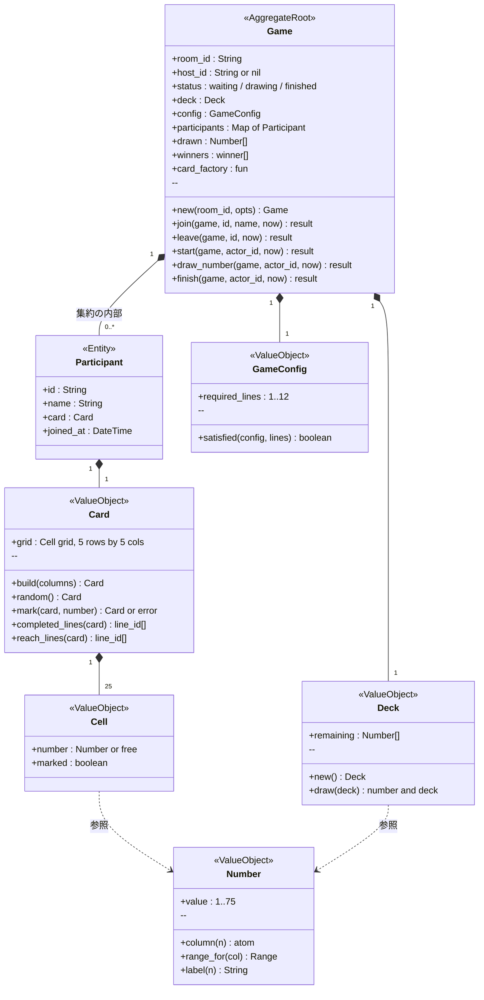
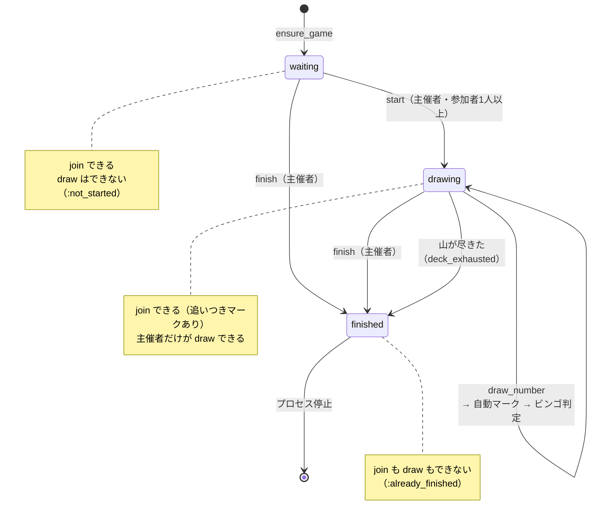
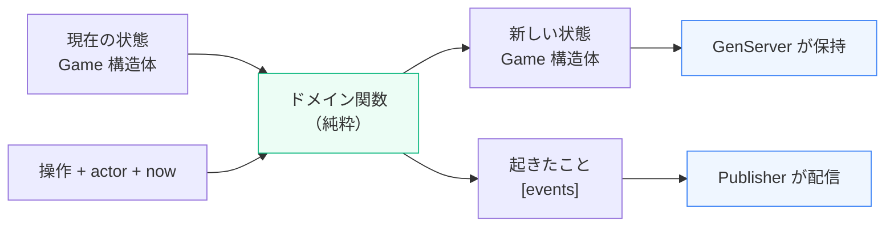
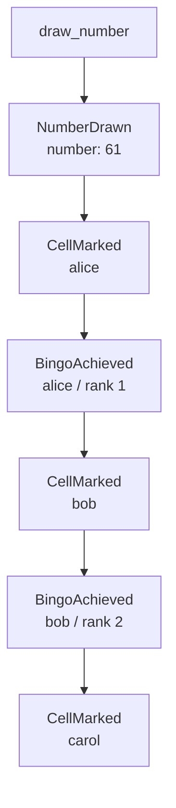
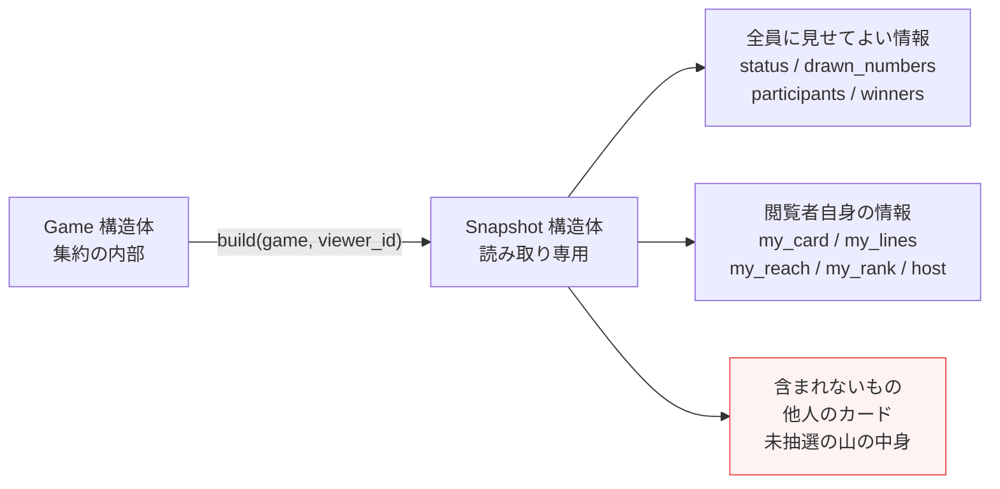

# ドメインモデル

## 1. 集約とその構成要素



### 集約の境界

**`Game` が集約ルート**で、`Participant` / `Card` / `Cell` / `Deck` はすべてその内側にある。
外から `Participant` や `Card` を直接書き換える経路は存在しない
（`GameServer` が `%Game{}` を外に出さないため）。

### なぜ Card はエンティティではなく値オブジェクトか

カードは参加者に紐づくので一見エンティティに見えるが、同一性は `Participant.id` が
担っているので、カード自身に ID を持たせる必要がない。

値オブジェクトとして扱い、`mark/2` が**新しいカードを返す**形にすることで、
ビンゴ判定という最もバグりやすいロジックを純粋関数のまま検証できる。

```elixir
assert {:ok, marked} = Card.mark(card, 17)
assert Card.completed_lines(marked) == [{:row, 0}]
```

---

## 2. 状態遷移



---

## 3. 不変条件（Invariants）

集約が守る 8 つのルールと、それがどこで担保されているか。

| # | 不変条件 | 担保している場所 | 破ろうとしたときの戻り値 |
|---:|---|---|---|
| 1 | 同じ番号は二度抽選されない | `Deck.draw/1`（山から取り除く） | `:exhausted` |
| 2 | `:drawing` でなければ抽選できない | `Game.ensure_status/2` | `:not_started` / `:already_finished` |
| 3 | **マークは抽選の結果としてのみ起きる** | 塗る API が存在しない（構造で保証） | — |
| 4 | 参加者は自分のカードしか持たない | 集約が `participants` を閉じ込めている | — |
| 5 | カードは入室時に一度だけ発行され、配置は不変 | `Game.join/4` が冪等 | — |
| 6 | ビンゴ達成は集約が自動判定し、同じ人が二度順位を取らない | `Game.maybe_achieve_bingo/5` | — |
| 7 | ビンゴ達成者のカードは上がり | `Game.apply_number/4`（`winner?` なら触らない） | — |
| 8 | 抽選の開始・実行・終了は主催者のみ | `Game.ensure_host/2` | `:not_host` |

### 特に効いている 2 つ

**不変条件 3** — 以前は「クライアントが送ってきた番号が抽選済みかサーバーが検証する」
方式だった。いまは**塗る経路が抽選しかない**ので、未抽選の番号が塗られること自体が
起こりえない。検証コードが消えて、不変条件はむしろ強くなった。

**不変条件 8** — 画面でボタンを隠すのは「表示上の制御」でしかなく、クライアントは
任意の `phx-click` を送れる。誰が操作してよいかはゲームのルールなので、集約が裁定する。
`host_id` 未設定なら誰も通さない（**既定で拒否**）。

```elixir
def draw_number(%__MODULE__{} = game, actor_id, now) do
  with :ok <- ensure_host(game, actor_id),      # 認可が先
       :ok <- ensure_status(game, :drawing) do  # 状態チェックは後
    do_draw(game, now)
  end
end
```

認可を状態チェックより先に置いているのは、非主催者に「もう終わっている」などの
内部状態を漏らさないため。

---

## 4. ドメインイベント

| イベント | フィールド | いつ起きるか |
|---|---|---|
| `ParticipantJoined` | `room_id` `participant_id` `name` `at` | 新規参加者がカードを受け取ったとき |
| `ParticipantLeft` | `room_id` `participant_id` `name` `at` | 明示的に退室したとき（接続断では起きない） |
| `GameStarted` | `room_id` `at` | 主催者が抽選を開始したとき |
| `NumberDrawn` | `room_id` `number` `column` `drawn_count` `remaining_count` `at` | 番号が 1 つ引かれたとき |
| `CellMarked` | `room_id` `participant_id` `number` `at` | 抽選または追いつきでマスが塗られたとき |
| `BingoAchieved` | `room_id` `participant_id` `name` `lines` `rank` `at` | 勝利条件を初めて満たしたとき |
| `GameFinished` | `room_id` `reason` `winners` `at` | 主催者が終了したとき、または山が尽きたとき |

### Decide → Evolve → Publish

この設計の背骨。すべての操作関数はこの形を返す。

```elixir
@spec draw_number(Game.t(), Participant.id(), DateTime.t()) ::
        {:ok, Game.t(), [Events.t()]} | {:error, atom()}
```



- **Decide / Evolve（純粋）** — 新しい state と「何が起きたか」を返す。副作用ゼロ
- **Publish（GenServer）** — 返ってきた events をそのまま PubSub に流す

GenServer は「何を通知すべきか」を知らなくてよく、ドメインは「どう配信されるか」を
知らなくてよい。結果として `Game` のテストは**プロセスも PubSub も Phoenix も起動せず**に
全網羅できる。

### 1 回の抽選が生むイベント列

自動マークを入れたことで、1 操作が複数の結果を生む。それを 1 つのリストで表現できる。



参加順に走査しているので、**同時にビンゴしたときの順位が決定的**になる。
Map の列挙順に任せると、同じ入力でも順位が変わりうる。

### タイムスタンプを引数で受け取る理由

各イベントは `at` を持つが、ドメイン関数の中で `DateTime.utc_now/0` を呼ぶと
そこが副作用になり「同じ入力なら同じ出力」が崩れてテストが書けなくなる。
そのため時刻は呼び出し側（= `GameServer`）から明示的に渡す。

---

## 5. 読み取りモデル（Snapshot）

集約の状態は `%Game{}` のままでは外に出さない。閲覧者視点に射影した
`Snapshot` だけを返す。



### viewer_id を取る理由

ビンゴでは他人のカードの中身が見えてはいけない。「誰の視点か」を射影の入力に
することで、**そもそも他人のカードがプロセスの外に出ない**。
これは表示上の都合ではなくドメインのルールなので、テンプレートの書き方に
委ねず、ここで担保する。

### 参加者一覧の並び順

```elixir
defp sort_key(%{rank: nil, joined_at: at}), do: {1, DateTime.to_unix(at, :microsecond)}
defp sort_key(%{rank: rank}), do: {0, rank}
```

ビンゴ達成者が rank 昇順で先頭、未達成者はその後ろに参加順。
「誰が何着か」がこの画面の主役なので、達成者を上に集める。
これは表示の関心事なので、ドメインではなく射影側に置いている。

---

## 6. 集約に残した非決定性

純粋関数といっても、カード生成と山のシャッフルは乱数を使う。
これを 2 箇所の**差し替え口**に閉じ込めてある。

| 口 | 既定値 | テストでの使い方 |
|---|---|---|
| `:deck` | `Deck.new/0`（シャッフル） | `Deck.new!([1, 16, 31, ...])` で抽選順を固定 |
| `:card_factory` | `&Card.random/0` | `&fixed_card/0` や `sequential_factory/1` で配るカードを固定 |

既定値のままなら本番の挙動になり、テストでは完全に決定的に検証できる。
`sequential_factory/1` は参加者ごとに違うカードを配れるので、
「carol だけがビンゴする」といった状況も決定的に作れる。
