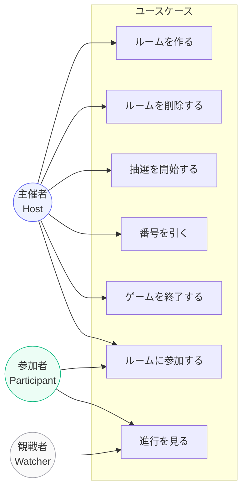
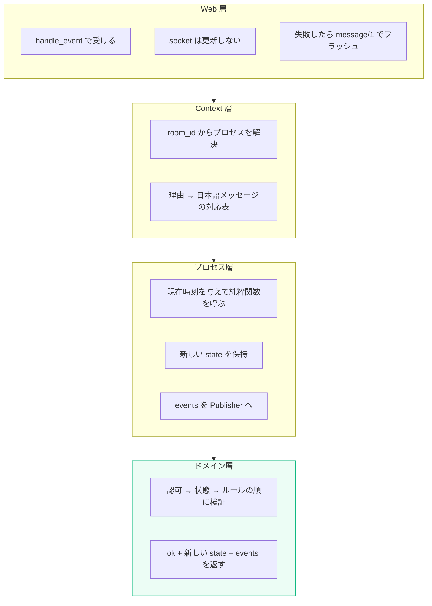
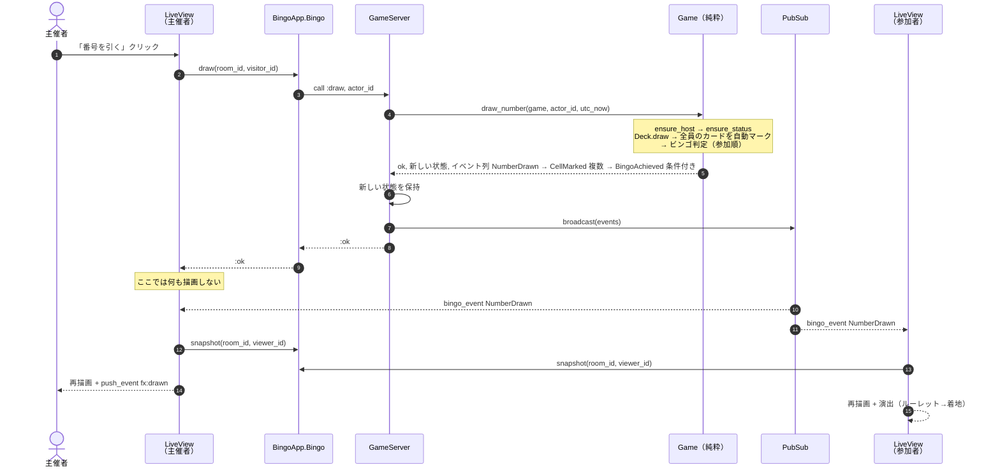
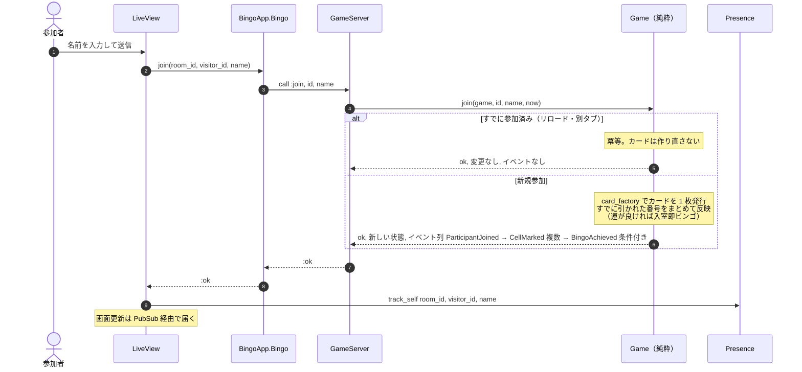
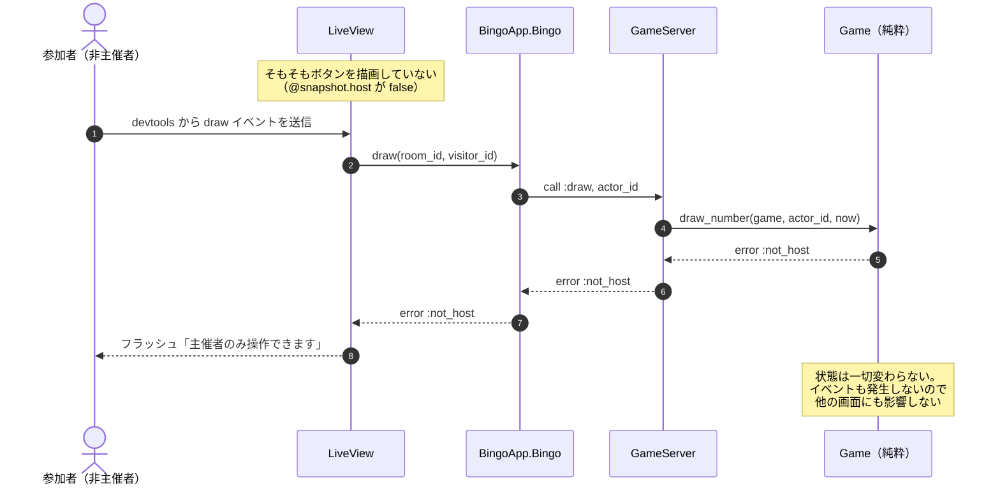
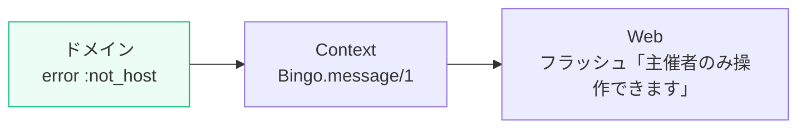
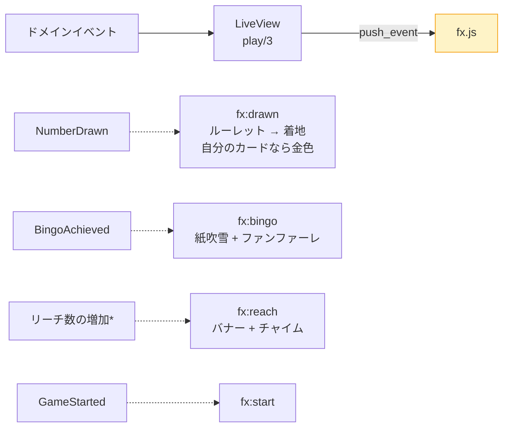

# ユースケース

## 1. アクター



| アクター | 定義 | 識別方法 |
|---|---|---|
| 主催者 | そのルームを作った人 | `Room.host_id == visitor_id` を集約が保持して判定 |
| 参加者 | カードを持っている人 | `Game.participants` に載っている |
| 観戦者 | ルームを開いているが未参加 | 上のどちらでもない |

> 主催者も `join` すればカードを持てる（主催者かつ参加者）。

---

## 2. ユースケース一覧

| # | ユースケース | アクター | 入口（Context API） | ドメイン操作 | 発生イベント | 失敗理由 |
|---:|---|---|---|---|---|---|
| 1 | ルームを作る | 主催者 | `Rooms.create_room/1` | — | `{:room_created, room}` | `:invalid_name` `:name_too_long` `:missing_host` |
| 2 | ルームを削除する | 主催者 | `Rooms.delete_room/1` | — | `{:room_deleted, room}` | `:not_found` |
| 3 | ゲームを用意する | （画面表示時に自動） | `Bingo.ensure_game/2` | `Game.new/2` | — | `:invalid_required_lines` |
| 4 | ルームに参加する | 参加者・主催者 | `Bingo.join/3` | `Game.join/4` | `ParticipantJoined` + 追いつき `CellMarked`* | `:invalid_name` `:already_finished` |
| 5 | 抽選を開始する | 主催者 | `Bingo.start_drawing/2` | `Game.start/3` | `GameStarted` | `:not_host` `:no_participants` `:already_started` |
| 6 | 番号を引く | 主催者 | `Bingo.draw/2` | `Game.draw_number/3` | `NumberDrawn` + `CellMarked`* + `BingoAchieved`* + `GameFinished`? | `:not_host` `:not_started` `:already_finished` `:exhausted` |
| 7 | ゲームを終了する | 主催者 | `Bingo.finish/2` | `Game.finish/3` | `GameFinished` | `:not_host` `:already_finished` |
| 8 | 退室する | 参加者 | `Bingo.leave/2` | `Game.leave/3` | `ParticipantLeft` | `:not_participating` |
| 9 | 進行を見る | 全員 | `Bingo.snapshot/2` | `Snapshot.build/2` | — | `:game_not_found` |

`*` = 人数分ゼロ回以上　`?` = 条件付きで 1 回

---

## 3. レイヤごとの責務

1 回の操作が層をどう通るか。



### handle_event が薄いことの実例

```elixir
def handle_event("draw", _params, socket) do
  {:noreply, dispatch(socket, &Bingo.draw(&1.room.id, &1.visitor_id))}
end

defp dispatch(socket, fun) do
  case fun.(socket.assigns) do
    :ok -> socket                                              # 画面は更新しない
    {:error, reason} -> put_flash(socket, :error, Bingo.message(reason))
  end
end
```

ビンゴのルール判断がここに一切無い。`GameServer` の `handle_call` も同様に、
どれも「純粋関数を渡すだけ」の同じ形をしている。判断がその層に無いことが
コードの形として現れている。

---

## 4. シーケンス図

### UC-6 番号を引く（本命のシナリオ）



**ポイントは 11〜16**。自分が起こした操作の結果も PubSub 経由で受け取る。
`handle_event` の中で socket を更新すると「自分の画面を更新するコード」と
「他人の画面を更新するコード」の 2 系統ができ、必ずどちらかがズレる。
更新経路を `handle_info` の 1 本に寄せれば、主催者も参加者も同じイベント列を見る。

### UC-4 ルームに参加する（途中参加の追いつき）



`join` を冪等にしているのが肝。LiveView はマウントのたびに `join` を呼ぶので、
ここが冪等でないとリロードのたびにカードが作り直され、塗った内容も順位も消える。

### UC-5 抽選を開始する（認可の流れ）



`actor_id` はセッション cookie 由来の `visitor_id` で、`socket.assigns` に
入っているためクライアントから偽装できない。画面側の `@snapshot.host` は
「押せないボタンを見せない」ための親切であって、防御ではない。

---

## 5. エラーの流れ

ドメインは `:not_host` のような**理由（atom）**を返すだけで、文言を持たない。
表示に近い Context 層で日本語に翻訳する。



これでドメイン層が UI の都合（言語・文言・トーン）から自由でいられる。

| 理由 | メッセージ |
|---|---|
| `:not_host` | 主催者のみ操作できます |
| `:not_started` | まだ抽選が始まっていません |
| `:already_started` | すでに抽選が始まっています |
| `:already_finished` | このゲームは終了しています |
| `:no_participants` | 参加者がいないため開始できません |
| `:exhausted` | すべての番号を引き終えました |
| `:invalid_name` | 名前を入力してください |
| `:game_not_found` | このゲームはすでに終了しています |

---

## 6. 演出の位置づけ

ドメインイベントを受けた **Web 層が** ブラウザへ効果を指示する。
ドメインは演出を知らない。



`*` リーチだけはイベントではなく、スナップショットの前後を比べて
「増えた瞬間」に鳴らしている。`Card.reach_lines/1` は純粋関数なので
判定そのものはドメイン側にある。

### 性能上の注意

1 回の抽選で参加者の人数ぶん `CellMarked` が飛ぶ。素通しすると
「人数 × 人数」回スナップショットを作り直すことになるので、
LiveView は**他人の `CellMarked` を捨てている**。

```elixir
def handle_info({:bingo_event, %Events.CellMarked{} = event}, socket) do
  if event.participant_id == socket.assigns.visitor_id do
    {:noreply, load_snapshot(socket)}
  else
    {:noreply, socket}   # 他人のマークは自分の画面に影響しない
  end
end
```
